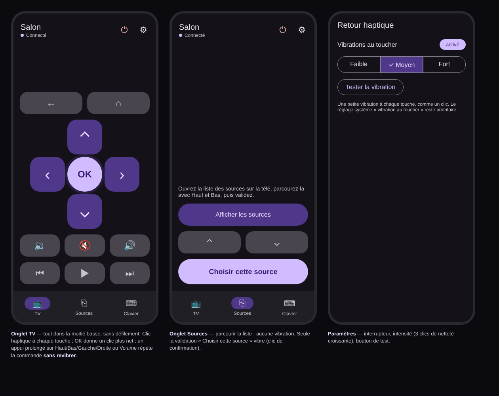

# La télécommande et le retour haptique

**Pour qui / pourquoi :** piloter une télé d'une main, sans regarder le téléphone.

> La maquette date d'avant la suppression de l'onglet *Sources* : la touche **Sources** est désormais dans
> l'onglet TV, sur la rangée Retour / Accueil / Sources.

## Disposition

- **En-tête** : nom de l'appareil (toucher pour renommer), indicateur *Connecté / Connexion… / Reconnexion… /
  Hors ligne*, marche, réglages.
- **Onglet TV**, dans la moitié basse, sans défilement : Retour / Accueil / Sources, pavé directionnel avec **OK**
  mis en avant, volume − / muet / +, précédent / lecture-pause / suivant.
- **Onglet Clavier** : le texte tapé est envoyé à la télé au fil de la frappe (Android TV : lettres sans accent,
  chiffres, espace ; Titan OS : pas encore pris en charge).

## Retour haptique

| Interaction | Retour |
| --- | --- |
| Touche ordinaire, pavé, volume, muet, retour, accueil, lecture | clic bref |
| **OK** | clic plus net |
| Appui prolongé (flèches, volume) | la commande se répète, **sans nouvelle vibration** |

*Paramètres › Retour haptique* : interrupteur **Vibrations au toucher** (activé par défaut), intensité
**Faible / Moyen / Fort**, bouton **Tester la vibration**. Si les vibrations au toucher sont coupées dans Android,
l'app ne vibre pas non plus (et le dit dans les réglages). Choix technique : [ADR](../architecture/2026-10-23-retour-haptique.md).

## Reconnexion au retour dans l'app

Après plus de 5 s en arrière-plan, la liaison est refaite aussitôt ; un bandeau avec barre de progression explique
que l'attente est normale. Les touches pressées pendant ce temps partent dès que c'est prêt.
